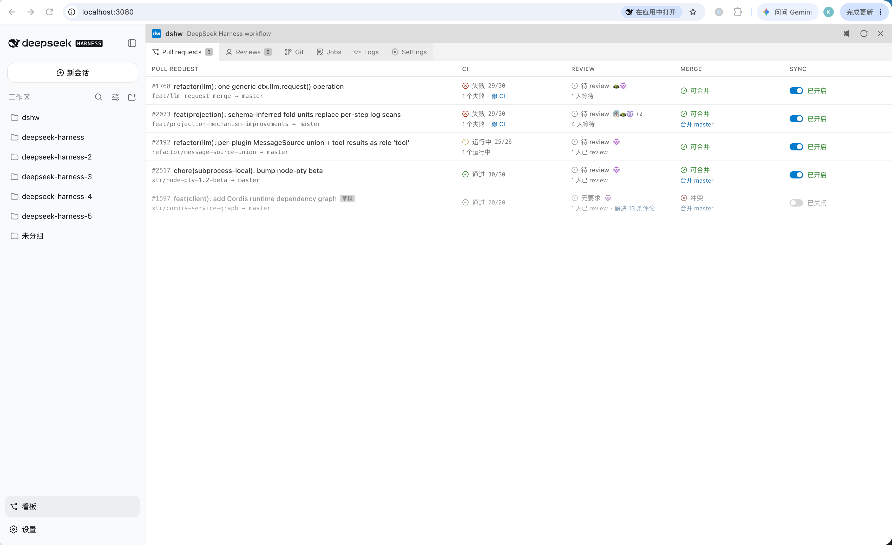

# dshw

> 个人开源项目，非 DeepSeek 官方产品。

`dshw` 是 DeepSeek Harness 的本机 PR 工作流工具，以看板形式嵌入 Harness Web。它会自动追踪你创建的、以及 assign 给你的 PR，克隆到本地独立目录，持续同步目标分支、监控 CI，并在需要时用 dsh Agent 自动处理冲突合并、修复 CI 失败、解决 review 评论。



## 功能

- **Pull requests**：按仓库列出你创建或 assign 给你的 open PR，展示 CI、review、合并与同步状态；冲突、落后、失败检查都有一键或自动处理入口。stacked PR 以 target master 的 PR 为顶层根节点，所有直接和间接依赖它的 PR 按深度优先顺序连续排列，统一缩进一层；其他 PR 保持顶层
- **Reviews**：列出待你 review 的 PR
- **Auto review**：PR Auto Reviewer 的结果列表，见下文
- **Git**：仓库分支与提交历史可视化
- **Jobs**：后台任务列表与详情，运行中的任务可 steer、暂停、终止
- **Logs**：服务与任务日志
- **Settings**：
  - **Repos**：选择要监控的 GitHub 仓库（勾选并排序，顺序即各页展示顺序）
  - **Workers**：配置 dsh / Codex 等执行器
  - **Auto review**：PR Auto Reviewer 的开关与配置
  - **System**：更新 dshw、同步主仓库、清理过期 worktree

支持同时监控多个仓库；新增仓库后，它的 PR 会被自动发现并展示。

看板会跟随所在面板的宽度排版：窄侧栏将视图选择和工具按钮收在一行，PR 以标题、分支和状态摘要呈现，点击状态行展开具体操作；宽面板保留多列表格。“展开看板”可临时放大整个工作区；在窄侧栏打开 Review diff 时也会自动展开，返回后恢复原列表与滚动位置。样式尺寸参考 VS Code Classic 的 SidebarTitle、ActionBar、SelectBox 和 Pane。

## 安装

在「DS 内部插件市场」安装「DSHW 工作看板」即可加载看板插件。看板连接本机 `http://127.0.0.1:7849` 服务；仍需按下述步骤在 macOS 上安装并启动 dshw daemon。

### 前置条件

- macOS
- Node.js 24.9+
- pnpm
- Git
- GitHub CLI，并已运行 `gh auth login`
- DeepSeek Harness 0.2.1-rc.3 及以上（当前支持 0.2.x 系列）

### 步骤

```sh
git clone https://github.com/kermanx/dshw.git
cd dshw
pnpm install
pnpm dshw start          # 初始化并后台启动服务
```

首次启动会准备托管仓库与运行时、构建插件、注册 LaunchAgent，可能需要几分钟。

然后把看板装进你的 dsh：

```sh
dsh plugin --profile web add "$PWD"
```

重启你的 dsh Web 服务（停掉后重新运行 `dsh web`），刷新页面即可在左侧栏的标准面板列表看到看板入口。看板使用 Harness 的 `sidebar.panellist` 与 `main` 面板接口，因此要求 dsh 0.2.1-rc.3 以上；插件的 `engines.dsh` 声明为 `>=0.2.1-rc.3 <0.3.0`，版本不匹配时 Harness 会跳过整个看板。插件列表在启动时组装，新增插件必须重启 dsh web 才会生效。

## 使用要点

- 看板数据由本机后台服务实时提供，无需手动刷新
- 服务默认监听 `127.0.0.1:7849`，可用环境变量 `DSHW_PORT` 修改
- 看板默认通过 dsh 的同源代理 `/api/dshw/*` 访问 daemon（由插件的 node half 注册，沿用 dsh 的 Host/Origin 与登录校验），所以远程/容器里只需要转发 dsh web 的端口，不必再单独转发 7849。代理目标可用 `DSHW_URL` 或 `DSHW_PORT` 指定；没有代理时会自动回退到 `http://127.0.0.1:7849`，也可以在连接失败界面手动改地址或点「使用默认地址」
- **更新**：`git pull` 后运行 `pnpm dshw restart` 即可。
- **卸载**：`dsh plugin --profile web remove dshw`，再重启 dsh web

## PR Auto Reviewer

让评审 Agent 盯着你的 PR：分支只要出现新提交，就先静默一小段时间，再运行
[dsh-dev-bench](../dsh-dev-bench) 里同款的 cc_bot 评审 bot，把意见按行锚定到 diff；需要时再起一个
dsh 会话逐条修复，并在面板里查看改动、继续对话。

- **入口**：侧栏看板的 **Auto review** 页；PR 列表中每行也有一个状态徽标（等待评审 / 评审中 / N 条意见 / 评审通过），点开即进入评审面板
- **面板**：左侧是概述与按文件分组的意见（点击定位到右侧 diff），右侧是「改动」（评审后的提交）与「修复会话」（进度、输出、追加指令）
- **修复会话**：用默认（或指定）Worker 起一个 dsh 会话，prompt 在 `prompts/auto-review-fix.md`，会带上评审概述和逐条意见，要求先判断意见是否成立再改
- **开关与配置**：Settings → Auto review —— 监控范围、静默期/最长等待、模型与凭据、引擎版本、是否评审后自动修复、触发级别、执行器、额外审查指令

### 前置条件

- `gh` 已登录，并能读取被监控仓库（评审读取 PR 标题/描述与提交）
- 评审模型：OpenAI 兼容的 chat-completions 端点；Key 可存进 dshw，也可用环境变量或 `~/.dsh/.env`
- 评审引擎：默认固定 `@earendil-works/pi-coding-agent@0.85.1`，首次评审时安装到 `.dshw/auto-review/engine/`（需要能访问 npm）。离线环境可用 `DSHW_REVIEW_ENGINE_DIR=<已安装目录>` 指向一份现成的安装

### 触发规则

- 每个 PR 第一次被发现时只记录 head，不立即评审（避免开启功能时把陈年分支全部跑一遍）
- head 变化后进入静默期：每来一个新提交就把截止时间往后推，但不会晚于「第一个提交 + 最长等待」
- 评审失败不会触发修复；自动修复每个 PR 最多连续 3 次，修复 push 后的新提交会被重新评审
- 手动「立即评审」不受开关限制，也不会被静默期推迟

### 飞书机器人

把 PR 进展推到飞书，并在话题里直接下指令。

1. 机器上装好并登录 `lark-cli`（`lark-cli auth status` 里 bot 与 user 身份都要 ready；dshw 只调用它，不保存任何应用密钥）
2. Settings → **Feishu**：开启、点「创建话题群」（会自动拉你进群并设为话题群），或者填已有话题群的 `oc_...`；「发送测试」确认连通
3. 之后每个 PR 第一次有进展时会开一个话题，后续进展都发在该话题里

**通知卡片**（从上到下，越短越好）：状态标题 → PR 编号 + 完整标题（普通文字，不加粗）→ 一行计数（必须修复 / 建议修复 / 建议，只给数量）→ 一行灰色状态（修复会话进行中/已完成/未启动 + 原因）→ 按钮。具体意见和本次评审开销（token 用量与估算费用）都在「打开评审页」里看。

**修复进度**：每个 PR 只有**一张卡片**。自动修复启动后，同一张卡片从「评审完成」变成「修复会话 · 进行中」并显示当前步骤，会话推进时原地更新（节流 10 秒）。

**修复不自动推送**：自动评审发现要修的问题后，会启动一个 dsh 会话，在 PR 的克隆里改代码，但**不提交、不推送**——改动留在工作区。同一会话里连续跑三轮：修复 → 自检（撤回超出 PR 范围的改动）→ 总结（2-4 句修复说明 + 注意事项）。结束后卡片变成「修复待确认（未推送）」并显示改动规模（如 `2 个文件 · +7 −2`），评审页的 `#fixdiff` 段显示完整 diff，并且每次对话后都会刷新。

确认没问题后，点卡片上的「推送」或在话题里说"推吧"，才会提交并 push；推送后卡片变成「已推送 · abc1234」，并继续走之后的评审。

**关于自动修复**：默认在评审出「必须修复 / 建议修复」的问题后自动启动 dsh 会话（Settings → Auto review → 修复 可关掉或改成只对「必须修复」触发）。没有启动时卡片会说明原因（未开启 / 未达到触发级别 / 已达次数上限 / 启动失败），而不是让你手打指令。

**不用打字的修复入口**：卡片主按钮会打开评审网页的修复区，页面上有一个「开始修复」按钮（普通表单 POST，不依赖飞书回调）；点它就启动会话并回到页面显示结果。话题里回复 `/fix` 只是备用入口。

**卡片按钮**（不需要打字）：

| 按钮 | 作用 |
|---|---|
| 开始修复 / 再修一次 | 直接启动一个 dsh 修复会话，卡片原地变成「进行中」 |
| 重新评审 | 立即重跑评审，卡片原地更新 |
| 打开评审页 | 打开只读评审网页（结论 / 意见 / diff / 修复状态） |

卡片是话题的**根消息**，所以话题列表里直接看到的就是卡片本身；修复进度也更新在同一张卡上。

**直接说话就行**：在话题里回复自然语言，dshw 会用最便宜的评审模型（`deepseek-flash`）做一次意图路由，然后：

| 你说 | 它做什么 |
|---|---|
| 「重新评审一下」「再看看」 | 重跑评审，卡片原地更新 |
| 「只修 critical 那几条」「把 X 改成 Y」 | 启动（或转达给）修复会话 |
| 「这条为什么算 critical？」 | 直接用评审上下文回答，不启动会话 |
| 「进度怎么样了」 | 汇报评审/修复状态 |
| 「先停一下」 | 让运行中的会话停下 |

路由失败时退回旧行为（把这句话当成修复指令）。需要看执行记录、diff 这些细节时才需要打开评审页。

**默认模型**：抄 cc_bot 的默认策略——主力 `anthropic/claude-opus-5.5`（它默认并行跑 `pi/opus-5.5` + `codex/gpt-6-astra` + `pi/deepseek-flash`，dshw 一次只跑一个）；设置面板的模型候选按 cc_bot 菜单排序（opus-5.5 / gpt-6-astra / deepseek-flash / fable-5.1 / gemini-4-argon / opus-5 / 4.8 / 4.6 / gpt-5.6-sol）。Claude 按 cc_bot 的 1M 上下文、128k 输出配置。

**评审引擎来源**：评审用的 Prompt、只读护栏扩展和结果校验移植自上游 [cc_bot](https://gitlab.deepseek.com/Ts2/cc_bot)（`config/pi/prompts/mr-review.md`、`config/pi/extensions/git-only-bash.ts`），同步于 `7202626a`（2026-11-06）；上游改了评审口径时，这几个文件需要手动对齐（`src/review/{prompt,extension-pi,validation,result}.ts` 的文件头都标了来源）。

**评审网页**：`/api/dshw/review/<repo>/<number>`（经 dsh 同源代理）是一个只读页面，包含结论、按文件分组的意见、评审后的 diff 和修复会话状态；卡片上的按钮就是打开它。

### 数据与本地目录

- `.dshw/auto-review.json`：开关、配置与每个 PR 的评审记录
- `.dshw/auto-review-secrets.env`：直接保存的 API Key（0600）
- `.dshw/auto-review/runs/<pr>-<时间>/`：每次评审的 checkout、prompt、引擎日志（含 Pi 的 session JSONL，token 用量从这里统计）
- `.dshw/feishu.json`：飞书开关、话题群、每个 PR 的话题线程和已处理的回复 id

### 演示数据（本机无 GitHub 时看 UI）

```sh
DSHW_DEV_MODE=1 DSHW_DEMO=1 DSHW_DEV_SKIP_MANAGED_HARNESS=1 DSHW_PORT=7849 pnpm dshw daemon
```

会用一个本地 demo 仓库和两条演示意见填充 Auto review 页；`DSHW_DEMO` 不设置时不会写入任何演示数据。

## Worker 配置

Settings 的 **Workers** 页可以维护多个执行器配置并拖动排序，第一项即默认执行器。支持：

- **dsh**：填写 Provider、模型、API Key 等即可使用
- **Codex**：使用本机 Codex CLI 与登录状态
- **Claude Code**：仅保留入口，尚未接入

直接输入的 API Key 不会出现在配置文件里，而是以受限权限单独保存。PR 操作按钮左键使用默认执行器，右键可为本次任务选择其他执行器。

## 任务控制

运行中的任务可以：

- **Steer**：在下一个 step 前插入指令
- **暂停 / 继续**：暂停当前 turn，输入新指令后继续同一个任务
- **终止**：结束任务

daemon 重启后会重新接管运行中的任务。

## 安全与运维

- dshw 只注册当前用户的 LaunchAgent，不使用 sudo，不创建系统级服务
- 所有数据都在仓库的 `.dshw/` 目录内（已被 Git 忽略）
- worker 使用独立的运行环境，不会写入你的全局配置
- 每份 clone 有独立身份；不同安装互不干扰，冲突操作会明确拒绝

### 常用命令

```sh
pnpm dshw start      # 初始化并启动
pnpm dshw stop       # 停止
pnpm dshw restart    # 构建插件并重启
pnpm dshw status     # 查看状态
pnpm dshw code       # 打开当前分支对应的 worktree
pnpm dshw doctor     # 检查环境
```

## 开发

```sh
pnpm check     # 类型检查 + 构建 + 测试
```

修改正式服务代码后运行 `pnpm dshw restart`。

### 以链接模式开发插件

```sh
dsh plugin --profile web add "$PWD"     # 之后插件直接从本目录加载
pnpm run build:plugin                  # 重新构建 client.js
```

改 `plugin/src/**` 后重新构建、刷新页面即可；改 `src/**`（daemon）后用
`DSHW_DEV_MODE=1 node --watch src/cli.ts daemon` 或 `pnpm dshw restart`。新增插件（或改 manifest）需要重启一次 dsh web。
